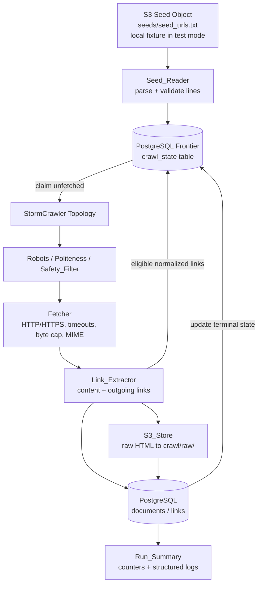
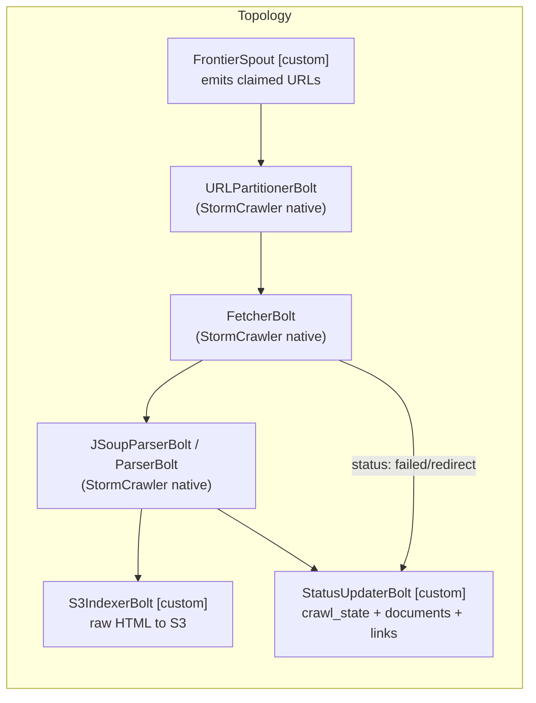
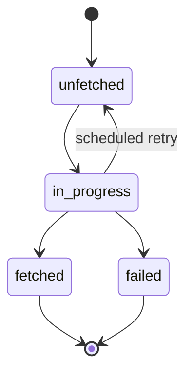
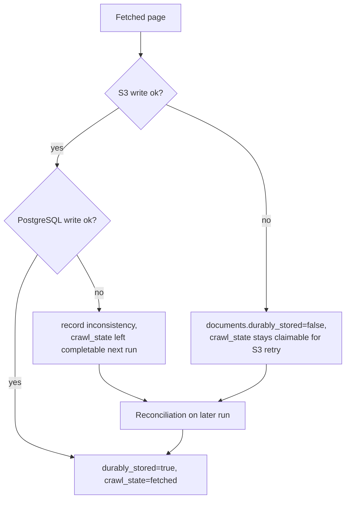

# Design Document: Crawler MVP

## Overview

This document describes the design for the **Crawler MVP** — the first vertical slice of the
general-purpose Web search engine. The slice reads seed URLs from an S3 object, maintains a
persistent crawl frontier in PostgreSQL, fetches permitted pages with **Apache StormCrawler**
under robots/politeness/budget controls, stores raw HTML in S3, and persists document metadata,
crawl state and directed graph edges in PostgreSQL.

The crawler is built on the **actual Apache StormCrawler framework** using its native spouts and
bolts; it is not a hand-written crawler. The only custom StormCrawler components introduced are a
PostgreSQL-backed frontier (spout + status-update bolt) and an S3 persistence bolt, both of which
are justified and tested as required by Requirement 14.5.

### Verified and pinned versions

The steering (`tech.md`, Requirement 14.2–14.4) requires verified-compatible, pinned versions
before implementation. Versions were verified against official sources:

| Component | Pinned version | Source / rationale |
|-----------|----------------|--------------------|
| Apache StormCrawler | `3.x` line, current `3.7.0` (group `org.apache.stormcrawler`) | [stormcrawler.apache.org/docs](https://stormcrawler.apache.org/docs/) lists 3.7.0 CURRENT; archetype `stormcrawler-archetype`. Final patch pinned from the archetype POM at build setup. |
| Apache Storm | `2.8.x` (latest stable 2.8.5) | [storm.apache.org/downloads](https://storm.apache.org/downloads.html). StormCrawler 3.x targets the Storm 2.x runtime; Storm requires Java 17+. |
| Java toolchain | **Java 17 LTS** | Both Storm and StormCrawler require Java 17+. Locally installed JDK 24 is not a supported target (Requirement 14.3). |
| Build tool | **Maven Wrapper (`mvnw`)**, committed | Maven is not installed in the target environment; the wrapper gives a reproducible build (Requirement 14.4). |
| PostgreSQL JDBC driver | `org.postgresql:postgresql` (42.x line) | Current stable driver compatible with Java 17 and PostgreSQL 14+. |
| AWS SDK | **AWS SDK for Java v2** (`software.amazon.awssdk:s3`) | Supports the standard credential provider chain and configurable region (Requirement 8.4, 8.5). |

> The exact patch versions are confirmed against the StormCrawler archetype `pom.xml` during build
> setup and recorded in `docs/` as an architecture decision. No version is invented
> (project-rules.md rule 4).

### Scope boundary (explicitly excluded from this design)

Per `product.md`, `project-rules.md` and the requirements' Out-of-Scope section, the following do
**not** appear anywhere in this design and MUST NOT be implemented in this slice: inverted index,
Hadoop MapReduce / SPIMI indexing, PageRank, QT5-Small / QMax quality scoring, focused-crawling /
distillation heuristics, sparse/dense retrieval and vector indexing, least-squares ranking, DPO
training, BERT / TF-Ranking reranking, SPRAWL, and BEIR TREC-COVID ingestion. **PostgreSQL is never
used as the inverted-index store** (Requirement 9.6).

## Architecture

### High-level flow

The system follows the flow mandated by `crawler-architecture.md`:



There is **no central master that manually forwards every URL** (crawler-architecture.md). The
frontier is a durable PostgreSQL queue; the StormCrawler spout pulls claims from it, and bolts push
status and newly discovered links back to it.

### StormCrawler topology

The topology is assembled with StormCrawler native abstractions. Custom adapters are marked
`[custom]` and justified under Requirement 14.5.



- **FetcherBolt**, **URLPartitionerBolt**, **JSoupParserBolt/ParserBolt** are StormCrawler's native
  components and provide robots handling, per-host partitioning/politeness, crawl-delay enforcement,
  timeouts, streaming/byte caps, MIME handling, redirect handling and link extraction. StormCrawler
  URL filters and parse filters (configured in `config/`) perform URL normalization and safety
  filtering.
- **FrontierSpout `[custom]`**, **StatusUpdaterBolt `[custom]`**, **S3IndexerBolt `[custom]`** are
  the only custom components. They exist because StormCrawler's reference status/indexer backends
  (Elasticsearch/OpenSearch, SQL modules) do not match the mandated PostgreSQL frontier/graph schema
  and S3 raw-HTML layout. Each custom adapter is documented in `docs/` and covered by tests
  (Requirement 14.5).

### Deployment and local services

- `docker-compose.yml` provides **PostgreSQL only** for local development/integration tests (no
  costly cloud infra without approval — project-rules.md rule 7).
- StormCrawler runs in Storm **local mode** for the MVP (via the Flux/`LocalCluster` runner), which
  needs no standalone Storm install for the bounded acceptance crawl.
- AWS S3 is the real managed bucket `web-search-engine-group9-2026-corp`; integration tests that
  require it honor Requirement 16.4 (report precise blocker, never claim passed).

## Components and Interfaces

All interfaces are described in Java (Java 17), matching the StormCrawler ecosystem. Signatures are
illustrative of contracts, not final code.

### Seed_Reader

Reads and validates seeds from S3 (or a local fixture in test mode), then inserts eligible seeds
into the frontier. (Requirements 1, 2.)

```java
public interface SeedReader {
    /** Reads seed source, parses/validates lines, inserts eligible seeds. */
    SeedLoadResult loadSeeds(SeedSource source, Frontier frontier);
}

public record SeedSource(boolean testMode, String s3Bucket, String s3Key, Path localFixture) {}

public record SeedLoadResult(
    int candidateLines, int validSeeds, int skippedInvalid,
    int duplicates, boolean runStopped, String stopReason) {}
```

Parsing rules (Requirement 1.3): each line is one candidate; trim leading/trailing whitespace; skip
lines that are empty after trimming and lines whose first non-whitespace character is `#` (comments)
without counting them as candidates. Invalid (non-HTTP/HTTPS or malformed) candidates are skipped
and counted (1.5). If the source is unreadable, or yields zero valid seeds, record a named error,
insert nothing, and stop the run (1.4, 1.7).

### URL_Normalizer

Pure functions for normalization and relative-link resolution. (Requirement 3, 6.3, 7.1.)

```java
public interface UrlNormalizer {
    /** Lowercase scheme/host only, strip fragment, strip default port, keep path/query case. */
    String normalize(String url) throws MalformedUrlException;
    /** Resolve a possibly-relative link against a base page URL to an absolute canonical URL. */
    String resolve(String baseCanonicalUrl, String link) throws MalformedUrlException;
}
```

Guarantees: idempotent normalization (3.8); fragment removal (3.2); default-port stripping with
non-default ports retained (3.3); path/query case and content preserved unless a configured policy
removes them (3.1, 3.5). Implemented as a StormCrawler `URLFilter` chain plus a thin pure wrapper so
it is directly unit/property testable.

### Safety_Filter

Enforces scheme, destination-address and page-type restrictions, including on redirects.
(Requirement 5.1–5.3, 5.7, 5.8.)

```java
public interface SafetyFilter {
    SafetyDecision check(String canonicalUrl);          // pre-fetch
    SafetyDecision revalidateRedirect(String targetUrl); // on redirect
}

public record SafetyDecision(boolean allowed, RejectReason reason) {}

public enum RejectReason {
    NONE, BAD_SCHEME, PRIVATE_OR_NONROUTABLE_ADDRESS,
    CLOUD_METADATA_ADDRESS, LOGIN_PAGE, UNSAFE_REDIRECT
}
```

Rejects any scheme other than `http`/`https` (case-insensitive) (5.1); rejects destinations that
resolve via DNS to loopback, link-local, private, non-routable, or cloud-metadata addresses (5.2);
skips identified login pages (5.3); redirect targets are re-resolved and re-checked before being
followed (5.7, 5.8).

### Robots_Policy

```java
public interface RobotsPolicy {
    RobotsRules rulesFor(String host);         // retrieve + cache with TTL
    boolean isAllowed(String host, String path);
    Optional<Duration> crawlDelay(String host);
}
```

Retrieves and caches parsed robots rules per host for a configurable TTL (default 3600s, range
60–86400) (4.1). On retrieval failure/server error, treats the host as allow-all for the TTL and
records it as unavailable in the Run_Summary (4.2). Provided primarily by StormCrawler's native
robots handling; the policy is surfaced through this interface for configuration and observability.

### Fetcher (StormCrawler FetcherBolt, configured)

Native StormCrawler `FetcherBolt` configured via `config/crawler-conf.yaml`:
- Disallowed URLs are skipped with no HTTP request; robots-exclusion counter incremented (4.3).
- Per-host crawl delay = max(declared crawl delay, configured host delay; default 1s, range 0–60)
  (4.4); per-host concurrency limit (default 2, range 1–10) (4.5).
- Connection timeout (default 10s, range 1–60) and read timeout (default 30s, range 1–120); on
  timeout, abort, discard partial response, record timeout failure (5.4).
- Streaming byte cap (default 10485760, range 1024–104857600), enforced by bytes read, not
  Content-Length alone (5.6).
- Allowed-MIME filtering: disallowed content type → discard body, do not store, record skip (5.5).
- Redirect hop limit (default 5, range 0–20): on limit, stop, do not store, record redirect-limit
  failure (5.9).
- Configurable non-empty User-Agent; run config is rejected before any fetch if User-Agent is
  missing (4.8).

### Link_Extractor (StormCrawler ParserBolt, configured)

Native parser bolt extracts page content and outgoing links with anchor text on successful fetch
(6.1, 6.2); each outgoing link is resolved against the fetched page URL to an absolute canonical URL
via `UrlNormalizer` (6.3).

### S3_Store

```java
public interface S3Store {
    /** Writes raw HTML under crawl/raw/ with a deterministic key; returns the key. */
    String putRawHtml(String canonicalUrl, byte[] body, String contentHash);
    boolean exists(String key);
}
```

Writes raw HTML to the Seed_Bucket under `crawl/raw/` (8.1); key is derived deterministically from a
stable document id or a collision-resistant content hash (8.2); the key is recorded in the
`documents` row (8.3); credentials come from the AWS SDK v2 default provider chain, never hardcoded
(8.4); region is read from verified configuration, not guessed (8.5); the bucket stays private with
Block Public Access (8.6).

### Metadata_Store

```java
public interface MetadataStore {
    DocumentId upsertDocument(DocumentRecord doc);     // idempotent on canonical_url
    void addLink(String srcCanonicalUrl, String dstCanonicalUrl, String anchorText);
    void markTerminal(String canonicalUrl, CrawlState state, int attempts, String error);
}
```

Persists `documents`, `links` and `crawl_state` with FK constraints and indexes via versioned
migrations (9.5). Supports `links` edges to destinations that are discovered-but-unfetched, without
requiring an existing fetched `documents` row (9.4). Never stores inverted-index data (9.6).

### Frontier (custom StormCrawler spout + status updater)

```java
public interface Frontier {
    InsertResult insert(FrontierEntry entry);          // unique on canonical_url
    Optional<Claim> claimNext(String workerId);        // unfetched -> in_progress (atomic)
    void complete(String canonicalUrl);                // in_progress -> fetched
    void fail(String canonicalUrl, String error);      // in_progress -> failed
    void scheduleRetry(String canonicalUrl, Instant nextAttempt); // in_progress -> unfetched
}
```

Claims are atomic and safe under concurrency (see Data Models). States and transitions are
DB-enforced (2.1). Inserts are deduplicated by the DB uniqueness constraint (2.4, 3.6, 3.7, 7.2).

### Observability / Run_Summary

```java
public interface RunSummary {
    void increment(Counter counter, long delta);
    Report finalize();   // emitted at end of run
}
```

Emits structured logs for seed reads, fetch attempts/outcomes, robots exclusions, storage writes and
errors (10.1, 10.3) and an end-of-run report with all mandated counters (10.2).

### Configuration / Crawl_Budget

```java
public record CrawlBudget(
    int maxPages, int maxDepth, int perHostConcurrency, Duration hostDelay,
    long maxResponseBytes, Duration connectTimeout, Duration readTimeout,
    List<String> allowedMimeTypes, int retryLimit, int maxRedirects,
    Duration robotsTtl, String userAgent) {}
```

All values are read from configuration/environment at run start and applied for the whole run;
unset values fall back to conservative built-in defaults; a missing User-Agent fails the run config
(Requirement 13, 4.8). Stored in `config/` and `.env.example` (placeholders only).

## Data Models

PostgreSQL schema created via versioned migrations in `db/migrations/` (9.5). All timestamps are
`timestamptz` in UTC (2.5).

### Enum: crawl state

Legal states and transitions (Requirement 2.1):



`fetched` and `failed` are terminal. No other transitions are legal.

### Table: crawl_state (frontier)

```sql
CREATE TYPE crawl_state_enum AS ENUM ('unfetched','in_progress','fetched','failed');

CREATE TABLE crawl_state (
    id              BIGSERIAL PRIMARY KEY,
    canonical_url   TEXT        NOT NULL,
    state           crawl_state_enum NOT NULL DEFAULT 'unfetched',
    priority        INTEGER     NOT NULL DEFAULT 500 CHECK (priority BETWEEN 0 AND 1000),
    depth           INTEGER     NOT NULL DEFAULT 0   CHECK (depth >= 0),
    parent_url      TEXT        NULL,
    attempts        INTEGER     NOT NULL DEFAULT 0   CHECK (attempts >= 0),
    next_attempt_at TIMESTAMPTZ NULL,
    last_error      TEXT        NULL,
    created_at      TIMESTAMPTZ NOT NULL DEFAULT now(),
    updated_at      TIMESTAMPTZ NOT NULL DEFAULT now(),
    CONSTRAINT uq_crawl_state_canonical UNIQUE (canonical_url)
);

CREATE INDEX ix_crawl_state_claimable
    ON crawl_state (state, priority DESC, next_attempt_at)
    WHERE state = 'unfetched';
```

The unique constraint enforces URL deduplication at the database level (3.6, 3.7). Depth 0 is the
seed depth; discovered links get `parent.depth + 1` (2.2, 7.1).

### Safe concurrent claim

Claiming uses a single atomic statement so concurrent workers cannot claim the same URL
(crawler-architecture.md "safe concurrent claims"):

```sql
UPDATE crawl_state
SET state = 'in_progress', attempts = attempts, updated_at = now()
WHERE id = (
    SELECT id FROM crawl_state
    WHERE state = 'unfetched'
      AND (next_attempt_at IS NULL OR next_attempt_at <= now())
    ORDER BY priority DESC, next_attempt_at NULLS FIRST, id
    FOR UPDATE SKIP LOCKED
    LIMIT 1
)
RETURNING id, canonical_url, depth, attempts;
```

`FOR UPDATE SKIP LOCKED` guarantees that each `unfetched` row is handed to at most one worker.

### Table: documents

```sql
CREATE TABLE documents (
    id            BIGSERIAL PRIMARY KEY,
    canonical_url TEXT        NOT NULL,
    http_status   INTEGER     NULL,
    content_type  TEXT        NULL,
    content_length BIGINT     NULL,
    content_hash  TEXT        NULL,
    s3_key        TEXT        NULL,
    durably_stored BOOLEAN    NOT NULL DEFAULT FALSE,
    crawled_at    TIMESTAMPTZ NULL,
    created_at    TIMESTAMPTZ NOT NULL DEFAULT now(),
    CONSTRAINT uq_documents_canonical UNIQUE (canonical_url),
    CONSTRAINT fk_documents_crawl_state
        FOREIGN KEY (canonical_url) REFERENCES crawl_state (canonical_url)
);

CREATE INDEX ix_documents_content_hash ON documents (content_hash);
```

Records canonical URL, HTTP status, content type, length, content hash, S3 key and crawl timestamp
(9.1). `durably_stored` and nullable `s3_key` support partial-failure reconciliation (Requirement
15). The unique constraint prevents duplicate rows across repeat runs (11.3).

### Table: links (directed Web graph edges)

```sql
CREATE TABLE links (
    id            BIGSERIAL PRIMARY KEY,
    src_url       TEXT        NOT NULL,
    dst_url       TEXT        NOT NULL,
    anchor_text   TEXT        NULL,
    discovered_at TIMESTAMPTZ NOT NULL DEFAULT now(),
    CONSTRAINT uq_links_edge UNIQUE (src_url, dst_url),
    CONSTRAINT fk_links_src FOREIGN KEY (src_url) REFERENCES crawl_state (canonical_url)
);

CREATE INDEX ix_links_src ON links (src_url);
CREATE INDEX ix_links_dst ON links (dst_url);
```

Directed edge from source page to each destination canonical URL with anchor text and discovery
timestamp (9.3). The `dst_url` deliberately has **no** FK to `documents` so edges can reference
discovered-but-unfetched destinations (9.4). The unique edge constraint keeps reruns idempotent.

### S3 object layout

- Bucket: `web-search-engine-group9-2026-corp` (private, Block Public Access).
- Key: `crawl/raw/<deterministic-id-or-content-hash>` (8.1, 8.2). The deterministic key makes
  repeat writes of the same page overwrite the same object rather than create duplicates (11.2).

## Correctness Properties

*A property is a characteristic or behavior that should hold true across all valid executions of a
system — essentially, a formal statement about what the system should do. Properties serve as the
bridge between human-readable specifications and machine-verifiable correctness guarantees.*

The acceptance criteria were analyzed for testability. Pure, input-varying logic (URL
normalization, safety filtering, frontier state transitions, dedup, retry/backoff, budget
resolution, counters) is expressed as the universally-quantified properties below. Criteria that are
infrastructure wiring (S3/PostgreSQL connectivity, robots retrieval, topology assembly), one-time
configuration/schema checks, or specific error scenarios are covered by integration, smoke and
example/edge tests in the Testing Strategy rather than as properties. Redundant criteria were
consolidated during property reflection (e.g. all dedup criteria collapse into one dedup property;
relative-link resolution criteria collapse into one).

### Property 1: Idempotent URL normalization

*For any* input URL string, applying `normalize` once and then applying `normalize` again to the
result SHALL produce a byte-for-byte identical canonical URL.

**Validates: Requirements 3.8**

### Property 2: Normalization correctness

*For any* valid HTTP/HTTPS URL, the canonical form SHALL have a lowercased scheme and host, the
original case of path and query preserved, no fragment component, the default port removed (80 for
`http`, 443 for `https`) while any non-default port is retained, and path/query otherwise preserved
(under the default no-removal policy).

**Validates: Requirements 3.1, 3.2, 3.3, 3.5**

### Property 3: Relative-link resolution yields absolute canonical URLs

*For any* base page canonical URL and any extracted or relative link, resolving the link against the
base SHALL produce an absolute canonical URL that includes both a scheme and a host.

**Validates: Requirements 3.4, 6.3**

### Property 4: Database-enforced URL deduplication

*For any* canonical URL, inserting it into the frontier more than once (in any order, from seeds or
from discovered links) SHALL result in exactly one stored row left unchanged after the first insert,
each subsequent insert returning a uniqueness-violation indication and incrementing the duplicate
counter; and repeat runs over the same inputs SHALL never create duplicate `documents` rows.

**Validates: Requirements 2.4, 3.7, 7.2, 11.3**

### Property 5: Frontier insert field invariants

*For any* inserted frontier entry, the stored row SHALL satisfy: state `unfetched`; `priority` in
[0, 1000]; `depth` a non-negative integer equal to 0 for seeds and `parent.depth + 1` for discovered
links; `attempts` a non-negative integer initially 0; `parent_url` null for seeds and set to the
discovering page for discovered links; and `created_at`/`updated_at` present as UTC timestamps.

**Validates: Requirements 2.2, 2.5, 7.1, 7.3**

### Property 6: Frontier state-transition legality

*For any* sequence of frontier operations applied to an entry, every realized state change SHALL be
one of the legal transitions (`unfetched`→`in_progress`, `in_progress`→`fetched`,
`in_progress`→`failed`, `in_progress`→`unfetched`), and once an entry reaches a terminal state
(`fetched` or `failed`) it SHALL NOT transition again; completing a fetch SHALL record the attempt
count and last-attempt timestamp on the terminal row.

**Validates: Requirements 2.1, 9.2**

### Property 7: Seed/link parsing excludes blanks and comments

*For any* list of seed source lines, no line that is empty after trimming, and no line whose first
non-whitespace character is `#`, SHALL become a candidate seed or be counted as a candidate.

**Validates: Requirements 1.3**

### Property 8: Only valid HTTP/HTTPS seeds survive, invalids counted

*For any* list of candidate seed entries, the entries inserted into the frontier SHALL be exactly
the distinct canonical forms of the well-formed HTTP/HTTPS entries (each inserted once), the
skipped-invalid counter SHALL equal the number of malformed or non-HTTP/HTTPS candidates, and
processing SHALL continue without stopping the run on an invalid entry.

**Validates: Requirements 1.5, 1.6**

### Property 9: Unsafe fetch targets are rejected without any request

*For any* URL, if its scheme is not exactly `http` or `https` (case-insensitive), or it resolves via
DNS to a loopback, link-local, private, non-routable, or cloud-metadata address, or it is classified
as a login page, then the Safety_Filter SHALL reject it and no HTTP request SHALL be issued for it;
conversely any allowed public HTTP/HTTPS, non-login target SHALL pass.

**Validates: Requirements 5.1, 5.2, 5.3**

### Property 10: Unsafe redirects are never followed

*For any* redirect chain, every redirect hop that the Fetcher follows SHALL have had its destination
re-resolved via DNS and revalidated against the scheme and resolved-address restrictions; any
redirect whose destination fails revalidation SHALL NOT be followed and SHALL be recorded as an
unsafe-redirect rejection.

**Validates: Requirements 5.7, 5.8**

### Property 11: Redirect hop bound

*For any* redirect chain and configured maximum redirect hop limit, the number of redirects followed
for a single original URL SHALL never exceed the limit, and reaching the limit SHALL stop following,
store nothing, and record a redirect-limit failure.

**Validates: Requirements 5.9**

### Property 12: Response byte cap is enforced by bytes read

*For any* response body of arbitrary size and any (possibly absent or inaccurate) Content-Length
header, the number of bytes read and stored SHALL never exceed the configured maximum response byte
cap, and bodies exceeding the cap SHALL be discarded without relying on Content-Length alone.

**Validates: Requirements 5.6**

### Property 13: MIME filtering

*For any* response, if its content type is not in the configured allowed-MIME list then the body
SHALL be discarded, not stored, and recorded as skipped for disallowed content type; only
allowed-type responses SHALL be stored.

**Validates: Requirements 5.5**

### Property 14: Robots exclusion prevents requests

*For any* host robots rules and any URL disallowed by those rules, the Fetcher SHALL skip the URL,
issue no HTTP request, and increment the robots-exclusion counter by one.

**Validates: Requirements 4.3**

### Property 15: Host crawl-delay politeness

*For any* sequence of successive requests to the same host, the elapsed time between consecutive
requests SHALL be at least the greater of the host's declared crawl delay and the configured host
delay.

**Validates: Requirements 4.4**

### Property 16: Per-host concurrency bound

*For any* arrival pattern of requests to a single host and any configured per-host concurrency limit,
the number of simultaneously in-flight requests to that host SHALL never exceed the limit.

**Validates: Requirements 4.5**

### Property 17: Depth budget bound

*For any* candidate link and configured maximum depth, if the link's depth (parent depth + 1) exceeds
the maximum depth then it SHALL be excluded from the frontier and never queued.

**Validates: Requirements 4.7**

### Property 18: Max-pages budget bound

*For any* stream of fetchable pages and any configured maximum pages budget (≥ 1), the number of
pages recorded as successfully fetched SHALL never exceed the budget, and the run SHALL complete once
in-flight fetches drain after the budget is reached.

**Validates: Requirements 4.6**

### Property 19: Non-empty User-Agent validation

*For any* run configuration, if the configured User-Agent is absent, empty, or blank then the run
configuration SHALL be rejected before any fetch is scheduled; a non-empty User-Agent SHALL be
accepted.

**Validates: Requirements 4.8**

### Property 20: Retry backoff is exponential with bounded jitter

*For any* attempt number n, the scheduled retry delay SHALL fall within the jittered exponential
bounds `[base·2^n·(1−j), base·2^n·(1+j)]` up to the configured maximum backoff, so that expected
delay grows with n.

**Validates: Requirements 12.1**

### Property 21: Retry bound and failure marking

*For any* URL subject to transient failures, the recorded attempt count SHALL never exceed the
configured retry limit; each scheduled retry SHALL increment the attempt count by exactly one and set
a future next-attempt timestamp; and when the attempt count reaches the retry limit the URL
`crawl_state` SHALL be marked `failed`.

**Validates: Requirements 12.2, 12.4**

### Property 22: Permanent failures are never retried

*For any* fetch outcome classified as a permanent failure, no retry SHALL be scheduled and the URL
`crawl_state` SHALL be marked `failed` with the failure detail recorded.

**Validates: Requirements 12.3**

### Property 23: Deterministic, idempotent S3 keys

*For any* page, the derived S3 object key SHALL be a deterministic function of its stable document
identifier or content hash (same input → same key, under `crawl/raw/`), so that writing the same page
again under an unchanged configuration produces no additional duplicate object.

**Validates: Requirements 8.2, 11.2**

### Property 24: Stored S3 key is recorded and recoverable

*For any* successfully stored page, the `documents` row SHALL record exactly the S3 key returned by
the S3_Store (store-then-read returns the same key).

**Validates: Requirements 8.3**

### Property 25: Document persistence completeness

*For any* successfully fetched page, the persisted `documents` row SHALL contain the canonical URL,
HTTP status, content type, content length, content hash, S3 key and crawl timestamp matching the
fetch outcome.

**Validates: Requirements 9.1**

### Property 26: Link extraction and edge persistence

*For any* fetched HTML document, the set of extracted outgoing links (with anchor text) SHALL equal
the anchors present in the document, and each distinct destination SHALL be persisted as a directed
`links` edge recording anchor text and a discovery timestamp — including destinations that have been
discovered but not yet fetched (no existing `documents` row required).

**Validates: Requirements 6.2, 9.3, 9.4**

### Property 27: Already-fetched URLs are skipped within the recrawl window

*For any* canonical URL in `fetched` state within the configured recrawl-policy window, a crawl run
SHALL skip refetching it and count it as a duplicate.

**Validates: Requirements 11.1**

### Property 28: Run summary counters are an exact tally

*For any* stream of crawl events, each Run_Summary counter (seeds, fetch attempts, successes,
failures, duplicates, robots exclusions, discovered links, S3 writes, database writes, bytes stored,
graph edges) SHALL equal the independently computed total of the corresponding events; and each
logged fetch outcome SHALL contain HTTP status, content type, final URL, content length, elapsed
fetch time and error detail.

**Validates: Requirements 10.2, 10.3**

### Property 29: Budget defaults fill unset values

*For any* configuration that omits an arbitrary subset of budget keys, the resolved Crawl_Budget
SHALL use the documented conservative default for each omitted key and the supplied value for each
provided key.

**Validates: Requirements 13.2**

### Property 30: Partial-failure reconciliation converges

*For any* page left in a partially-stored state (raw HTML in S3 but no metadata, or metadata present
but `durably_stored = false`), a subsequent run SHALL reconcile it to a consistent state — either
fully stored (both S3 object and complete metadata) or `failed` — without assuming cross-service
atomicity.

**Validates: Requirements 15.4**

## Error Handling

Error handling is organized by failure domain and never claims cross-service atomicity
(Requirement 15.1).

### Seed loading errors
- **Unreadable seed source (1.4)**: record a structured error naming the seed source and the failure
  cause, insert no seeds, stop the run with a non-zero exit.
- **Zero valid seeds (1.7)**: record a structured error naming the source and that no valid
  HTTP/HTTPS seeds were found, insert nothing, stop the run.
- **Invalid individual seed (1.5)**: skip, increment `skipped_invalid`, continue.

### Fetch and network errors
- **Timeouts (5.4)**: on connect/read timeout, abort the request, discard any partial response,
  record a timeout failure; treated as a Transient_Failure eligible for bounded retry.
- **Transient failures (12.1, 12.2, 12.4)**: HTTP 429/5xx, connection resets and timeouts are retried
  with exponential backoff + jitter up to the retry limit, after which the URL is marked `failed`.
- **Permanent failures (12.3)**: HTTP 404/410, disallowed or malformed URLs are marked `failed`
  immediately with detail and never retried.
- **Redirect-limit reached (5.9)**: stop following, store nothing, record redirect-limit failure.
- **Unsafe redirect (5.8)**: do not follow, record unsafe-redirect rejection.

### Robots errors
- **Robots unavailable/server error (4.2)**: treat host as allow-all for the TTL and record the host
  as having an unavailable robots.txt in the Run_Summary.

### Storage and partial-failure recovery (Requirement 15)
The S3 write and the PostgreSQL metadata write are **separate, non-atomic** steps. Recovery uses the
`documents.durably_stored` flag and nullable `s3_key`:



- **S3 ok, PostgreSQL fails (15.2)**: record the inconsistency; leave the URL in a state a later run
  can complete (write the missing metadata).
- **PostgreSQL ok, S3 fails (15.3)**: mark `durably_stored = false`; leave the URL eligible for a
  later S3 write retry.
- **Reconciliation (15.4)**: a later run detecting a partially-stored page (via `durably_stored`,
  `s3_key`, and object existence) drives it to a consistent `fetched`+durably-stored state or to
  `failed`.

### Configuration errors
- **Missing User-Agent (4.8)**: reject the run configuration before scheduling any fetch.
- **Missing/invalid region (8.5)**: fail fast; the region is resolved and verified from configuration.
- **Unresolved budget values (13.2)**: fall back to conservative defaults rather than failing.

### Database integrity
- Uniqueness violations on `canonical_url` and `(src_url, dst_url)` are caught and surfaced as
  deduplication outcomes (not fatal), incrementing duplicate counters (3.7, 11.3).

## Testing Strategy

The feature mixes pure, input-varying logic (well suited to property-based testing) with
infrastructure wiring and one-time configuration (suited to integration, smoke and example tests).
Both are used. The project targets **Java 17** with **JUnit 5**; property-based tests use
**jqwik** (a mature JVM property-based testing library) — property-based testing is **not**
implemented from scratch.

### Property-based tests (jqwik)

- Each correctness Property 1–30 is implemented by a **single** jqwik property test.
- Each property test runs a **minimum of 100 iterations** (`@Property(tries = 100)` or higher).
- Each test is tagged with a comment referencing its design property, in the format:
  `// Feature: crawler-mvp, Property {number}: {property_text}`.
- Generators are built for: URLs (mixed case, fragments, default/non-default ports, relative/absolute
  forms, varied schemes), resolved IP addresses across loopback/link-local/private/non-routable/
  cloud-metadata/public ranges (via an injected resolver so no real DNS is needed), HTML documents
  with known anchor sets, seed-source line lists, redirect chains, response bodies with varied sizes
  and Content-Length, fetch-outcome/event streams, retry-attempt sequences, and partial configs.
- Network, DNS, S3 and clock are injected as test doubles so property tests stay pure, fast and
  deterministic, enabling 100+ iterations cheaply.

The pure components (`UrlNormalizer`, `SafetyFilter`, seed parser, retry/backoff scheduler,
`RunSummary` counters, budget resolver, frontier state machine) are designed as thin,
dependency-injected units specifically so these properties are directly testable in isolation.

### Unit / example / edge-case tests (JUnit 5)

Focused example and edge tests cover criteria that are specific scenarios rather than universal
properties:
- Test-mode fixture wiring (1.2); unreadable source and zero-valid-seeds stops (1.4, 1.7).
- Robots TTL expiry and allow-all-on-failure (4.1, 4.2).
- Connect/read timeout abort-and-discard (5.4).
- Content extraction on a controlled page (6.1).
- Structured-log emission per event type (10.1).
- Budget resolved once and fixed for the run (13.3).
- Partial-failure injection: S3-ok/DB-fail and DB-ok/S3-fail (15.2, 15.3).

### Integration tests

- **End-to-end slice (16.2)**: seed read → frontier insert → controlled permitted fetch → link
  extraction → duplicate rejection → S3 raw-HTML write → PostgreSQL persistence, run against a
  local PostgreSQL (via `docker-compose.yml`), a controlled local HTTP fixture server, and either
  the real private S3 bucket or a mocked S3 client.
- **Repeat-run deduplication (11.1–11.3, 16.2)**: run the slice twice over the same seeds and assert
  no duplicate S3 objects and no duplicate `documents` rows.
- **Frontier durability (2.3)**: insert, restart the process, assert queue contents persist.

### Smoke / configuration / schema tests

- Schema/migration checks: unique constraint on `crawl_state.canonical_url` (3.6), FK constraints and
  indexes present (9.5), no inverted-index tables/columns (9.6).
- AWS: client built from the default credential provider chain with no hardcoded credentials (8.4);
  region resolved and verified (8.5); bucket private / Block Public Access (8.6).
- Build/toolchain: pinned versions present (14.2), Java 17 target (14.3), committed Maven Wrapper
  builds (14.4), native StormCrawler bolts used in the topology (14.1), custom-adapter docs + tests
  present (14.5).
- Test-coverage presence for the mandated unit tests (16.1) and documented setup/run/verification
  steps in `docs/`/`README.md` (16.3).

### Honest verification reporting (Requirement 16.4)

If a test cannot run because required AWS or PostgreSQL configuration is missing, the harness marks
the test **failed**, states the precise missing-configuration blocker (e.g. which environment
variable or credential is absent), and **never** marks it passed. Generated code alone is never
reported as a passing result; build, test and end-to-end evidence is required (project-rules.md
rules 13–14, `tech.md`).

### Requirements traceability summary

- Properties 1–30 validate the testable logic of Requirements 1–13 and 15.
- Integration tests cover Requirements 1.1, 2.3, 11.1–11.3, 16.2.
- Smoke/example/edge tests cover Requirements 1.2, 1.4, 1.7, 4.1, 4.2, 5.4, 6.1, 8.1, 8.4–8.6, 9.5,
  9.6, 10.1, 13.1, 13.3, 14.1–14.5, 15.1–15.3, 16.1, 16.3, 16.4.
